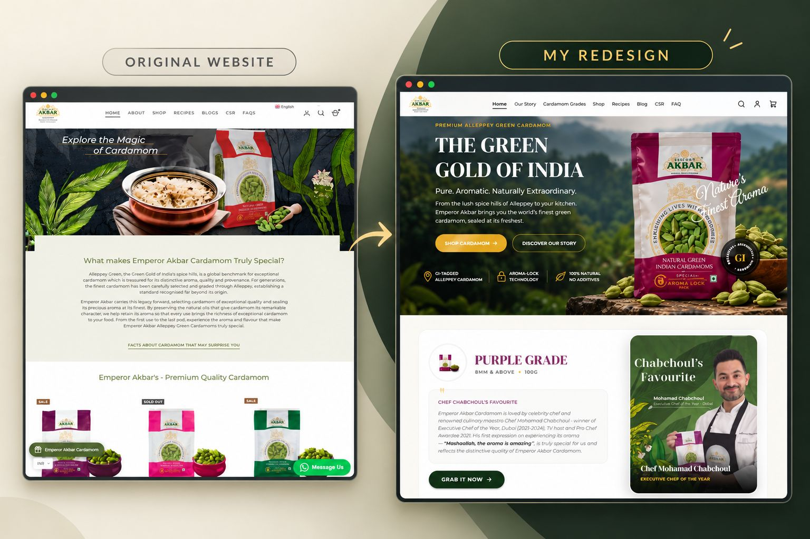
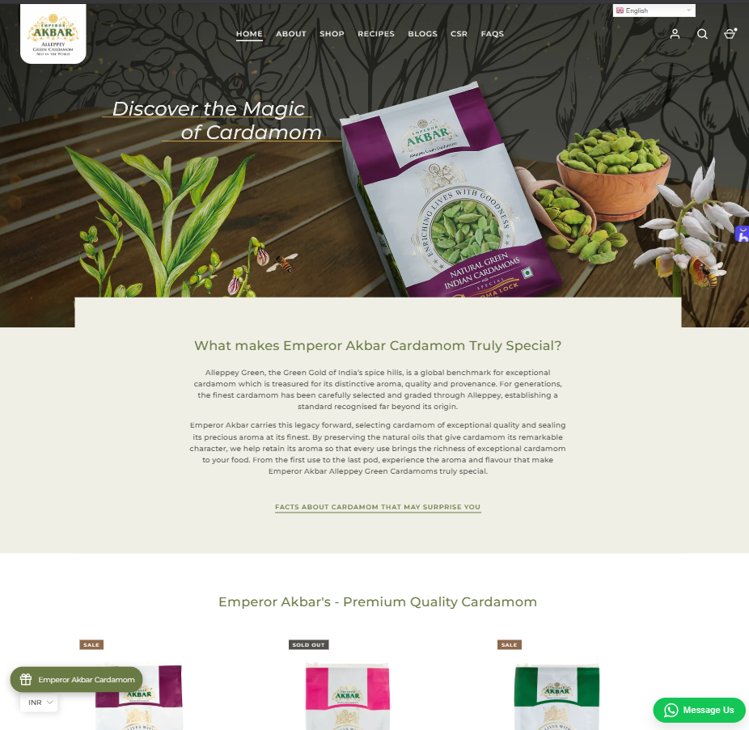
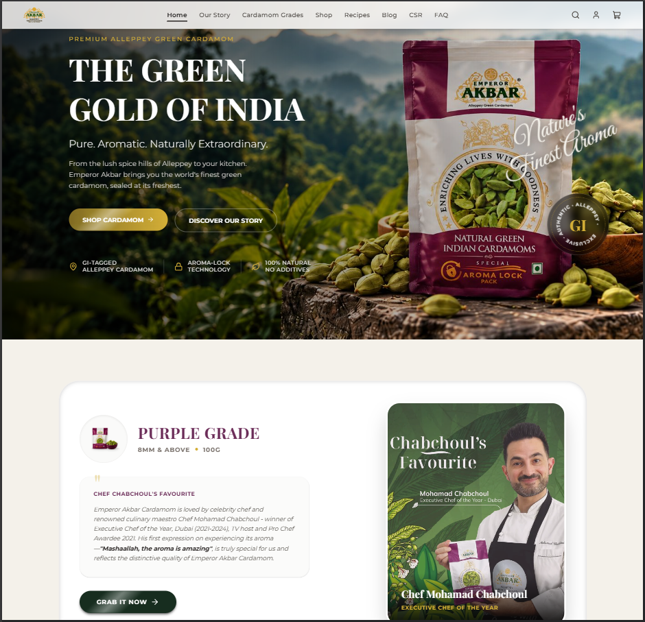

# 🌿 Emperor Akbar Cardamom — Website Redesign

> **A luxury, modern digital flagship experience redesigning [Emperor Akbar Cardamom](https://www.emperorakbar.com/) — the world's premier exporter of GI-tagged authentic Alleppey green cardamom from India.**

[](https://dotsatya.github.io/EmperorAkbar-Cardamom-Web-Redesign/)
[](https://nextjs.org/)
[](https://react.dev/)
[](https://tailwindcss.com/)
[](https://www.typescriptlang.org/)
[](LICENSE)

---

## 🌐 Live Deployment & Project Links

* **🚀 Live Deployed Website:** [https://dotsatya.github.io/EmperorAkbar-Cardamom-Web-Redesign/](https://dotsatya.github.io/EmperorAkbar-Cardamom-Web-Redesign/)
* **🏛️ Original Website:** [https://www.emperorakbar.com/](https://www.emperorakbar.com/)
* **📦 GitHub Repository:** [dotsatya/EmperorAkbar-Cardamom-Web-Redesign](https://github.com/dotsatya/EmperorAkbar-Cardamom-Web-Redesign)

---

## 📸 The Transformation: Before & After



### Side-by-Side Comparison

| Original Website (`old.png`) | Redesigned Website (`new.png`) |
| :---: | :---: |
|  |  |
| **Traditional Shopify Store Layout**<br>Static banners, generic typography, boxy cards, and standard product lists. | **Luxury Heritage Flagship Experience**<br>Rich Alleppey emerald (`#1b4b36`) and gold (`#d4af37`), glassmorphism, fluid typography, interactive grading, and modern micro-interactions. |

---

## 🎯 Redesign Vision & Problem Statement

[Emperor Akbar Cardamom](https://www.emperorakbar.com/) is recognized globally as the gold standard in green cardamom — GI-tagged, harvested in the misty spice hills of Alleppey, and packaged with world-class Aroma-Lock technology. It is championed by culinary legends including **Executive Chef of the Year Mohamad Chabchoul**.

However, the original web presence was built on an older template with several limitations:
1. **Generic E-commerce Feel:** The original look lacked the premium, regal branding befitting the "Green Gold of India".
2. **Static Grade Showcase:** Cardamom pod grading (Purple 8mm+, Pink 7.5mm+, Green 7-8mm, Orange 6.5-7mm, Red 6-6.5mm) was presented through plain tabular data rather than an interactive visual experience.
3. **Fragmented Storytelling:** The rich heritage of Alleppey GI certification, aroma-lock vacuum sealing, culinary collaborations, and health benefits were buried across disconnected pages.
4. **Mobile Navigation & Cart UX:** The purchasing funnel was rigid, lacking instant feedback and sleek modern drawers.

### 💡 The Solution
This redesign reimagines Emperor Akbar as an **exclusive luxury spice boutique**, combining high-performance frontend engineering (Next.js 16, React 19, Tailwind CSS v4) with an editorial, heritage-inspired design system.

---

## ✨ Key Features & User Experience

### 👑 1. Regal & Immersive Hero Experience
* High-impact hero section showcasing the misty Alleppey spice hills, aroma-lock packaging, and GI-tag validation.
* Distinctive typography combining **Playfair Display**, **Montserrat**, and editorial script accents (**Great Vibes**).
* Shimmering call-to-action buttons (`ShinyButton`) with dynamic light-sweep animations.

### 🔍 2. Interactive Cardamom Grades Visualizer
* Located at `/cardamom-grades`, an interactive visual grading system allows consumers and chefs to explore pod sizes, diameters, flavor intensity, and culinary uses:
  * 🟣 **Purple Grade (8 mm & above):** The crown jewel, handpicked for royal confections and culinary royalty.
  * 🌸 **Pink Grade (7.5 mm & above):** Bold, full-bodied pods with intense aroma oils.
  * 🟢 **Green Grade (7 mm – 8 mm):** The classic premium grade, versatile for daily curries and biryanis.
  * 🟠 **Orange Grade (6.5 mm – 7 mm):** Vibrant pods for teas, baking, and aromatic seasoning.
  * 🔴 **Red Grade (6 mm – 6.5 mm):** High essential oil concentration, economical for powdered blends.

### 🛒 3. State-of-the-Art E-Commerce Engine
* **Dynamic Global Cart Context (`CartProvider`):** Real-time cart state management with instant badge updates, quantity controls, and local persistence.
* **Interactive Weight Selectors:** Switch seamlessly between package sizes (50g, 100g, 250g, 500g) with live price updates.
* **Dedicated Product Pages (`/product/[id]`):** High-resolution image carousels, tasting profiles, storage instructions, and "Buy Now" quick checkout.

### 🍲 4. Culinary Collaborations (Shimi's Kitchen)
* Curated recipe portal (`/recipes` and `/recipes/[slug]`) featuring exclusive dishes developed with Shimi's Kitchen:
  * *Cardamom Rasmalai*
  * *Cardamom Pistachio Latte*
  * *Elaichi Milk Tea*
  * *Elaichi Payasam*
* Complete ingredient checklists, cooking steps, difficulty ratings, and cook times.

### 🌿 5. "Doctor of Spices" Health & Wellness Hub
* Dedicated `/health-benefits` section highlighting medicinal benefits: digestion, respiratory wellness, oral health, and antioxidants.
* Interactive slider and informative cards referencing ancient Ayurvedic traditions and modern nutritional science.

### 📜 6. Rich Heritage & Brand Storytelling
* Dedicated `/our-story` timeline documenting decades of spice mastery, grading precision, and export excellence.
* `/csr` portal showcasing fair-trade farmer welfare, eco-friendly practices, and community programs in Kerala.
* Comprehensive `/faq` with accordion-based instant answers.

### 🎭 7. Curtain-Reveal Modern Footer
* Custom `FooterRevealWrapper` creates an elegant page-slide reveal effect over the deep forest-green footer.

---

## 🛠️ Technology Stack & Architecture

| Layer | Technologies Used |
| :--- | :--- |
| **Framework** | [Next.js 16.4](https://nextjs.org/) (App Router, Turbopack, Static Export) |
| **UI Library** | [React 19.3](https://react.dev/) |
| **Language** | [TypeScript 5](https://www.typescriptlang.org/) |
| **Styling** | [Tailwind CSS v4](https://tailwindcss.com/), `@tailwindcss/typography` |
| **Typography** | Google Fonts (`Montserrat`, `Playfair Display`, `Great Vibes`) via `next/font` |
| **Icons** | [Lucide React](https://lucide.dev/) |
| **State Management** | React Context API (`CartProvider`) |
| **CI / CD & Hosting** | [GitHub Actions](https://github.com/features/actions) → [GitHub Pages](https://pages.github.com/) |

---

## 📂 Project Directory Structure

```plaintext
emperorakbar-web-redesign/
├── .github/
│   └── workflows/
│       └── deploy.yml              # Automated GitHub Actions workflow for GitHub Pages
├── app/
│   ├── blog/                       # Spice market blogs & articles
│   │   ├── [slug]/                 # Dynamic blog post route with generateStaticParams
│   │   └── page.tsx                # Blog directory & filters
│   ├── cardamom-grades/            # Interactive Cardamom Grades Visualizer
│   │   └── page.tsx
│   ├── cart/                       # Shopping Cart & Checkout review
│   │   └── page.tsx
│   ├── csr/                        # Corporate Social Responsibility & Sustainability
│   │   └── page.tsx
│   ├── faq/                        # Frequently Asked Questions accordion
│   │   └── page.tsx
│   ├── health-benefits/            # Health & Wellness "Doctor of Spices" hub
│   │   └── page.tsx
│   ├── our-story/                  # Alleppey heritage & company timeline
│   │   └── page.tsx
│   ├── product/
│   │   └── [id]/                   # Dynamic product detail page (generateStaticParams)
│   ├── recipes/                    # Culinary recipes with Shimi's Kitchen
│   │   ├── [slug]/                 # Dynamic recipe detail page (generateStaticParams)
│   │   └── page.tsx
│   ├── shop/                       # Full product catalog & filter system
│   │   └── page.tsx
│   ├── privacy-policy/             # Privacy Policy statement
│   │   └── page.tsx
│   ├── return-policy/              # Return & refund guidelines
│   │   └── page.tsx
│   ├── shipping-policy/            # Shipping & delivery guidelines
│   │   └── page.tsx
│   ├── terms-and-conditions/       # Terms & conditions legal page
│   │   └── page.tsx
│   ├── globals.css                 # Design tokens, custom animations, glassmorphism
│   ├── layout.tsx                  # Root layout with Fonts, CartProvider, Header & Footer
│   ├── robots.ts                   # Search crawler directives (/robots.txt)
│   ├── sitemap.ts                  # Dynamic XML sitemap generator (/sitemap.xml)
│   └── page.tsx                    # Redesigned Homepage
├── components/
│   ├── HomePageSections/           # Hero, Badges, Chef Chabchoul, Featured Grade, Recipes
│   ├── cardamom-grades-components/ # Visualizer area, diameter circles, Grade tabs
│   ├── policy/                     # Standardized policy layout with navigation tabs
│   ├── BlogCard.tsx                # Blog article card with reading time & tags
│   ├── BlogList.tsx                # Interactive blog search & category filters
│   ├── CartProvider.tsx            # Global cart state provider & calculations
│   ├── CartView.tsx                # Interactive cart drawer & checkout calculation
│   ├── Footer.tsx                  # Deep forest-green luxury footer
│   ├── FooterRevealWrapper.tsx     # Curtain-reveal scroll transition
│   ├── Header.tsx                  # Responsive glass navbar with navigation & cart badge
│   ├── HealthBenefitsSlider.tsx    # Interactive health wellness benefits carousel
│   ├── HealthTopicsGrid.tsx        # Grid showcase of cardamom health benefits
│   ├── JsonLd.tsx                  # SEO Structured Data component
│   ├── ProductCard.tsx             # Universal product card with variant selector
│   ├── RecipeCard.tsx              # Culinary recipe card with cook time & difficulty
│   ├── RecipesList.tsx             # Interactive recipes catalog with search
│   └── ShinyButton.tsx             # Shimmer-effect royal gold CTA button
├── data/
│   └── websiteData.ts              # Complete single source of truth (products, recipes, blogs)
├── public/
│   ├── .htaccess                   # Apache 301 canonical redirects (www & non-www)
│   ├── _redirects                  # Netlify/Cloudflare static 301 redirects
│   ├── .nojekyll                   # Bypasses Jekyll on GitHub Pages to serve _next/ assets
│   ├── apple-touch-icon.png        # Apple touch icon for mobile bookmarking
│   ├── images/                     # Logos, hero backgrounds, badge icons
│   ├── purple/, pink/, green/...   # High-resolution grade package photography
│   └── xreadme/                    # README assets (old-to-new.jpg, old.png, new.png)
├── next.config.ts                  # Static export configuration (output: export, basePath)
└── package.json                    # Project dependencies and scripts
```

---

## 🗺️ Pages & Routing Overview

| Route | Page Description | Type |
| :--- | :--- | :---: |
| `/` | Redesigned Homepage (Hero, Chef Chabchoul, Aroma-Lock, Recipes) | Static |
| `/cardamom-grades` | Interactive Cardamom Visualizer & Pod Size Comparison | Static |
| `/shop` | Full E-Commerce Shop with Filter & Multi-Weight Variants | Static |
| `/product/[id]` | Dynamic Product Details (Purple, Pink, Green, Orange, Red) | SSG |
| `/cart` | Dynamic Cart, Quantity Manager, Order Calculation | Static |
| `/recipes` | Culinary Portal (Recipes in collaboration with Shimi's Kitchen) | Static |
| `/recipes/[slug]` | Step-by-Step Cooking Guide & Ingredient Lists | SSG |
| `/blog` | Articles, Market Analysis & Cardamom Buying Guides | Static |
| `/blog/[slug]` | Individual Blog Post Detail View | SSG |
| `/health-benefits` | "Doctor of Spices" Wellness Guide | Static |
| `/our-story` | Brand Heritage & Alleppey GI-Tag Certification | Static |
| `/csr` | Corporate Social Responsibility & Farmer Welfare | Static |
| `/faq` | Interactive Frequently Asked Questions | Static |
| `/privacy-policy` | Privacy Policy Statement | Static |
| `/terms-and-conditions` | Terms & Conditions | Static |
| `/shipping-policy` | Shipping and Delivery Guidelines | Static |
| `/return-policy` | Return and Refund Guidelines | Static |

---

## 🚀 Getting Started Locally

### 1. Clone the repository
```bash
git clone https://github.com/dotsatya/EmperorAkbar-Cardamom-Web-Redesign.git
cd EmperorAkbar-Cardamom-Web-Redesign
```

### 2. Install dependencies
```bash
npm install
```

### 3. Run the development server
```bash
npm run dev
```

Open [http://localhost:3000](http://localhost:3000) (or [http://localhost:3000/EmperorAkbar-Cardamom-Web-Redesign/](http://localhost:3000/EmperorAkbar-Cardamom-Web-Redesign/)) in your browser.

### 4. Build static export for production
```bash
npm run build
```
This generates the optimized static bundle in the `./out` directory.

---

## 🚢 Deployment on GitHub Pages

This project is configured for **automated static export deployment** using GitHub Actions:

1. **Static Export Settings (`next.config.ts`):**
   * `output: "export"` generates pure HTML/CSS/JS without requiring a Node.js server.
   * `basePath: "/EmperorAkbar-Cardamom-Web-Redesign"` handles GitHub Pages subpath routing.
   * `trailingSlash: true` ensures clean URL routing without 404s.
   * `images: { unoptimized: true }` enables static Next.js image exports.
2. **Jekyll Bypass (`public/.nojekyll`):**
   * Automatically included in the build output to ensure GitHub Pages does not ignore the `_next/` directory.
3. **Automated CI/CD Workflow (`.github/workflows/deploy.yml`):**
   * On every push to `main`, GitHub Actions automatically installs dependencies, executes `npm run build`, and deploys the `./out` directory directly to GitHub Pages.

---

## 👨‍💻 Author & Credits

* **Redesign & Development:** [Satya (dotsatya)](https://github.com/dotsatya)
* **Internship Project:** Developed during internship at **CodeWarrior Technologies Pvt. Ltd.**
* **Original Brand & Asset Rights:** [Emperor Akbar Cardamom](https://www.emperorakbar.com/) (All trademarks, brand assets, and imagery belong to their respective owners).